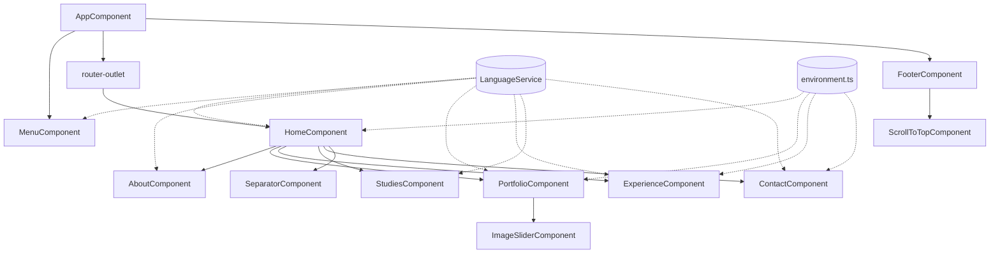

# Náiluj's Portfolio

Personal portfolio of **Julián González Prieto**, Fullstack Software Developer from Bogotá D.C., Colombia.

🌐 Live site: **https://nailuj-portfolio.vercel.app/**

> *Náiluj* has one simple explanation: it's my name backwards.

## Objective

This project is a single-page web application that presents my professional profile in a clean, visual and bilingual way. It is meant to be the one link I can share with recruiters, clients and colleagues to show:

- **Who I am**: a short introduction, my location and links to my CV, LinkedIn, GitHub and Bitbucket.
- **What I work with**: the languages, frameworks, databases and tools I use.
- **What I have built**: featured projects with screenshot carousels, plus a slider of other projects that link to their repositories.
- **Where I have worked**: my work history as a timeline-style slider, with the technologies used in each role.
- **What I have studied**: my degrees and certifications.
- **How to reach me**: email and phone/WhatsApp contacts.

All content can be read in **English** or **Spanish**, and visitors switch between them from the menu.

## Tech stack

| Area | Technology |
|------|------------|
| Framework | [Angular 20.3](https://angular.dev/) (standalone components) |
| Language | TypeScript 5.8 (strict mode) |
| Rendering | Angular SSR with build-time **prerendering** (`@angular/ssr`) |
| UI | Angular Material, custom CSS, Font Awesome icons |
| Server | Express (SSR entry point in `server.ts`) |
| Analytics | Vercel Analytics and Vercel Speed Insights |
| Package manager | pnpm |
| Hosting | Vercel |
| Testing | Karma + Jasmine |

## Architecture overview

The app is a **single-route Angular application**. One `HomeComponent` stacks every section of the page vertically, and the menu moves between sections with in-page anchors (`#about`, `#portfolio`, ...) instead of router navigation.



### Project structure

```
src/
├── app/
│   ├── components/        # Page sections (one per menu entry)
│   │   ├── home/          # Hero section; hosts all other sections
│   │   ├── about/         # Introduction and tech skills
│   │   ├── portfolio/     # Featured projects and "other projects" slider
│   │   ├── experience/    # Work history slider
│   │   ├── studies/       # Education
│   │   └── contact/       # Contact information
│   ├── elements/          # Reusable UI building blocks
│   │   ├── menu/          # Top navigation + language toggle
│   │   ├── footer/
│   │   ├── image-slider/  # Generic screenshot carousel
│   │   ├── scroll-to-top/
│   │   └── separator/
│   ├── services/          # LanguageService (i18n), MailService
│   ├── model/dto/         # Translation dictionary and DTOs
│   ├── app.config.ts      # Client providers (router, hydration, animations, HTTP)
│   ├── app.config.server.ts  # Server-rendering providers
│   └── app.routes.ts
├── environments/          # Links, contact data, and per-build variables
├── assets/                # Images, project screenshots, technology SVG icons
└── main.ts / main.server.ts  # Browser and server bootstrap
server.ts                  # Express server used for SSR
```

TypeScript path aliases (`@components/*`, `@elements/*`, `@services/*`, `@model/*`, `@environments/*`) are defined in `tsconfig.json` to keep imports short.

### Key design decisions

- **Standalone components.** There are no `NgModule`s. Each component declares its own imports, and the app starts with `bootstrapApplication`.
- **Content kept apart from layout.** Section data (jobs, projects, technologies) lives in plain TypeScript arrays inside each component. External URLs and contact details are kept together in `src/environments/environment.ts`, so updating the portfolio rarely means touching templates.
- **Home-made internationalization.** `src/app/model/dto/language.ts` holds a dictionary that maps each text key to its English and Spanish versions. `LanguageService` saves the selected language in `sessionStorage` and returns the right text through `getText(key)`. The default language comes from the build variables: English in production, Spanish in development.
- **SSR + prerendering.** The page is rendered to static HTML at build time for faster first paint and better SEO, then hydrated in the browser (`provideClientHydration`). `server.ts` adds host-header validation to protect the SSR server against SSRF.
- **Technology icons by convention.** Technologies are referenced by name (e.g. `"angular"`), which resolves to `assets/svg/<name>.svg`, so adding a new tool only takes a new SVG file.

## Getting started

### Prerequisites

- Node.js 24.x
- pnpm

### Install and run

```bash
pnpm install
```

```bash
pnpm dev
```

The development server opens at `http://localhost:4200/` with Spanish as the default language.

### Available scripts

| Command | Description |
|---------|-------------|
| `pnpm dev` | Start the Angular dev server and open the browser |
| `pnpm build` | Production build with prerendering (output in `dist/nailuj-portfolio`) |
| `pnpm preview` | Build, then serve the static output with Express (`server.js`) |
| `pnpm test` | Run unit tests with Karma |

## Deployment

The site is deployed on **Vercel**. On every push, Vercel installs dependencies with pnpm and runs `ng build` (see `vercel.json`), then serves the prerendered output.

## Author

**Julián González Prieto**
- LinkedIn: [julian-gonzalez-prieto](https://www.linkedin.com/in/julian-gonzalez-prieto-bb7b70140/)
- GitHub: [@nailuj1992](https://github.com/nailuj1992)
- Bitbucket: [pegasus1992](https://bitbucket.org/pegasus1992/)
